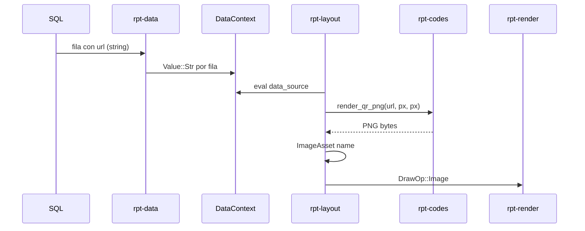

# QR desde campo URL (diseño C)

↑ [[rpt-rs]]

**Estado:** diseño aprobado por implementar (spec)  
**Fecha:** 2026-11-17  
**Espejo repo:** `docs/superpowers/specs/2026-11-17-qr-url-field-design.md`

## Objetivo

En un `.rpt`, un objeto enlazado a un **campo string** (URL por fila, vía SQL) debe renderizar un **código QR distinto en cada fila** del detalle, con tamaño tomado del cuadro del objeto en la banda.

## No objetivos (v1)

- Decodificar un tipo de objeto QR propietario de Crystal en binario `.rpt` (investigar después).
- QR desde fórmula arbitraria (solo campo enlazado `{Tabla.campo}`).
- Code 39 u otros símbolos (mismo crate, otra variante v2).
- Generar QR en capa SQL/ETL (diseño A).

## Contexto actual

- `rpt-codes::render_qr_png` existe; solo lo usa `rpt-codes-cli`.
- `emit_blob_field` ya hace asset por fila (`{name}#{instance}`) y dibuja imagen.
- `BlobField` espera **bytes** de imagen, no URL.

## Decisión: variante C

Nuevo subtipo de objeto, paralelo a `BlobField`:

| Pieza | Responsabilidad |
|-------|-------------------|
| `QrUrlFieldObject` | Guardar `data_source` (referencia `{…}`) |
| `ReportObjectKind::QrUrlField` | Variante en el enum (rompe compilación en KDL/render hasta completar) |
| KDL `qr-url-field` | Autoría y fixtures **v1** |
| `rpt-layout` | Resolver URL por fila → PNG → `ImageOp` |
| `rpt-codes` | Codificación QR |

### Por qué no reutilizar solo `BlobField`

Semántica explícita, sin convertir strings en blobs binarios por accidente, y documentación clara para autores.

## Modelo (`rpt-model`)

```rust
// Conceptual — alinear nombres con BlobFieldObject
pub struct QrUrlFieldObject {
    pub data_source: String, // "{Command.url_column}"
}
```

- Misma forma que `BlobFieldObject` (solo `data_source`).
- `origin: RecordRef` sigue en `ReportObject` padre.
- Wire `.rpt` v1: **no** — entrada solo KDL / construcción programática; `Deferred` si en el futuro aparece rtype.

## Autoría KDL (v1)

Nodo hermano de `blob-field`:

```kdl
qr-url-field "QrProduct" x=1000 y=500 w=1440 h=1440 data-source="{Products.qr_url}"
```

- `w` y `h` deben ser **iguales** (twips cuadrados). Si difieren: layout usa `min(w,h)` para el QR y centra en el bounds (o error en modo strict — elegido: **escalar en cuadrado min, letterbox en bounds**, coherente con picture).

## Flujo de datos



## Layout (`rpt-layout`)

1. Añadir dependencia `rpt-codes = { workspace = true }`.
2. Nuevo método `emit_qr_url_field` (o rama en `emit_object`), copiando estructura de `emit_blob_field`:
   - `blob_value` no aplica; usar **`eval_field_ref`** / mismo camino que campos string (`resolve` existente).
3. Normalizar URL: trim; vacío → placeholder (misma imagen vacía que blob sin asset).
4. Tamaño en píxeles: `mm_to_pixels` desde twips del bounds y DPI del informe (default 300 si no hay opción global; alinear con `rpt-codes` CLI default).
5. Llamar `render_qr_png(&url, side, side)`.
6. Registrar asset `format!("{}#{}", name, instance)` con `media_type: image/png`.
7. `ImageFit::Contain` en bounds del objeto.

### Límites y errores

| Caso | Comportamiento v1 |
|------|-------------------|
| URL vacía / null | Placeholder (sin asset) |
| Longitud > 4096 bytes UTF-8 | Diagnóstico + placeholder |
| `render_qr_png` falla | Diagnóstico en layout (como EMF/picture) + placeholder |
| Valor no string | Tratar como `ToString` del `Value` si es URL-like; si número/blob → diagnóstico |

## Superficie a tocar (checklist implementación)

| Crate / app | Cambio |
|-------------|--------|
| `rpt-model` | `QrUrlFieldObject`, enum variant |
| `rpt-kdl` | export + import `qr-url-field` |
| `rpt-layout` | `emit_qr_url_field`, match en `place`, `used_fields` vía query crate |
| `rpt-query` | `used_fields` para `QrUrlField` |
| `rpt-render` | match exhaustivo en skips/walk si aplica |
| `rpt-reader` | opcional v2: rtype si existe en corpus |
| tests | layout: 3 URLs → 3 assets distintos en Page IR |

## Pruebas

1. **Unit:** `render_qr_png` ya cubierto en `rpt-codes`.
2. **Layout integration:** informe KDL mínimo + `Dataset` en memoria con 3 filas y URLs distintas; assert 3 `image_id` distintos y bytes PNG válidos en assets.
3. **Regression:** informes existentes sin `qr-url-field` sin cambio.

## Fases

| Fase | Entregable |
|------|------------|
| **1** | Model + KDL + layout + test integration |
| **2** | Doc en `docs/rendering/` + ejemplo meridian |
| **3** | Reader `.rpt` si aparece wire format en fixtures |

## Riesgos

- Crystal designer no exporta nuestro nodo → autores usan KDL/meridian hasta parity.
- DPI: documentar que el tamaño físico del QR depende de twips + DPI de conversión.

## Aprobación

Tras revisión, siguiente paso: plan de implementación (`writing-plans`), no código hasta OK explícito.